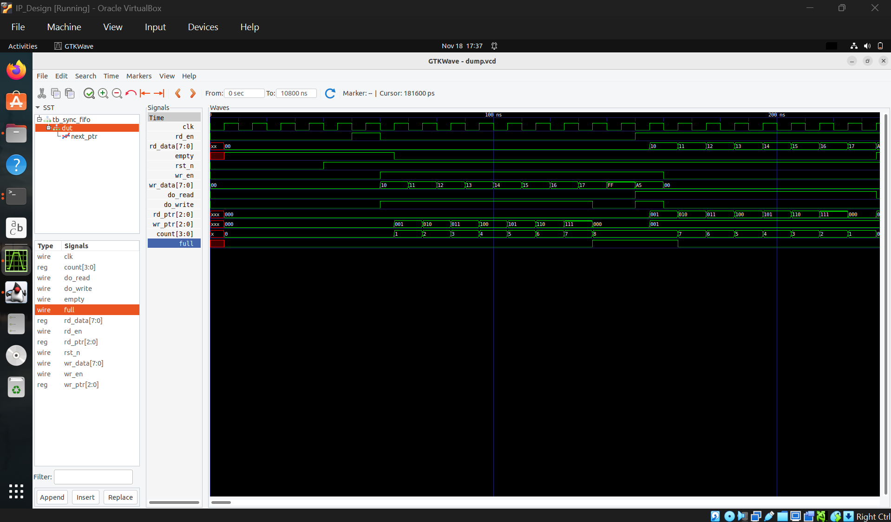

# Synchronous FIFO RTL Design and SystemVerilog Verification


## 1. Project Overview

This project implements an **8-bit, 8-entry synchronous FIFO (First-In First-Out)** using Verilog RTL, with a self-checking verification environment written in SystemVerilog.

The FIFO provides temporary data buffering between producer and consumer logic operating in the same clock domain.

The design supports:

- Parameterized data width and FIFO depth
- Circular read and write pointers
- Full and empty status generation
- Occupancy tracking
- Overflow and underflow protection
- Simultaneous read/write transactions
- Registered read-data output
- Active-low asynchronous reset
- Automatic pointer wraparound

The testbench performs directed and randomized verification, compares the DUT against an independent reference model, tracks important coverage events, and generates VCD waveforms for GTKWave.

**Verified result: 1,072 transactions, zero detected scoreboard errors.**

---

## 2. Design Specifications

| Parameter | Specification |
|---|---|
| Architecture | Single-clock synchronous FIFO |
| RTL language | Verilog |
| Testbench language | SystemVerilog |
| Data width | 8 bits |
| FIFO depth | 8 entries |
| Total storage | 64 bits |
| Read pointer | 3 bits |
| Write pointer | 3 bits |
| Occupancy counter | 4 bits |
| Clock domains | 1 |
| Testbench clock period | 10 ns |
| Testbench clock frequency | 100 MHz |
| Reset | Active-low asynchronous |
| Read data | Registered output |
| Full/empty detection | Occupancy counter |
| Overflow protection | Supported |
| Underflow protection | Supported |
| Simultaneous read/write | Supported |
| Simulator | Icarus Verilog |
| Waveform viewer | GTKWave |
| Operating environment | Ubuntu Linux |

The 100 MHz value is the simulation clock frequency, not a measured hardware maximum frequency.

The supplied configuration uses `DATA_WIDTH=8`, `DEPTH=8`, `PTR_WIDTH=3`, and `COUNT_WIDTH=4`. Parameter widths must be configured consistently when changing the depth.

---

## 3. FIFO Architecture

```text
                   SYNCHRONOUS FIFO
                         |
                       clk
                         |
         +---------------+---------------+
         |                               |
         v                               v
   WRITE CONTROL                   READ CONTROL
     wr_en                            rd_en
   wr_data[7:0]                    rd_data[7:0]
         |                               ^
         v                               |
   +-------------+                 +-------------+
   | Write       |                 | Read        |
   | Pointer     |                 | Pointer     |
   | wr_ptr[2:0] |                 | rd_ptr[2:0] |
   +------+------+                 +------+------+
          |                               |
          v                               |
   +------------------------------------------+
   |                                          |
   |              FIFO MEMORY                 |
   |                                          |
   |             8 x 8-bit entries            |
   |                                          |
   |              mem[0:7]                    |
   |                                          |
   +------------------------------------------+
                         |
                         v
                 OCCUPANCY COUNTER
                     count[3:0]
                         |
                 +-------+-------+
                 |               |
                 v               v
                full            empty
```

### Main components

**FIFO memory:** Stores eight data entries, each eight bits wide.

**Write pointer:** Identifies the next location for an accepted write.

**Read pointer:** Identifies the oldest entry to be read.

**Occupancy counter:** Tracks the number of valid stored entries.

**Control logic:** Determines whether read and write requests can be accepted.

---

## 4. RTL Interface

| Signal | Direction | Width | Function |
|---|---|---|---|
| `clk` | Input | 1 | Common clock |
| `rst_n` | Input | 1 | Active-low reset |
| `wr_en` | Input | 1 | Write request |
| `rd_en` | Input | 1 | Read request |
| `wr_data` | Input | 8 | Input data |
| `rd_data` | Output | 8 | Registered output data |
| `full` | Output | 1 | FIFO full indicator |
| `empty` | Output | 1 | FIFO empty indicator |
| `count` | Output | 4 | Occupancy count |

### Internal signals

- `wr_ptr`: Write pointer
- `rd_ptr`: Read pointer
- `do_write`: Accepted write
- `do_read`: Accepted read
- `mem`: FIFO storage array

---

## 5. FIFO Working Principle

### 5.1 Reset

When `rst_n = 0`:

- Write pointer becomes zero.
- Read pointer becomes zero.
- Occupancy count becomes zero.
- Read-data output becomes zero.
- Empty flag asserts.
- Full flag deasserts.

The memory array itself is not reset. Its contents are considered invalid after reset because occupancy is zero.

### 5.2 Write operation

A write is accepted when the FIFO is not full, or when a simultaneous read frees space.

```verilog
assign do_write = wr_en && (!full || do_read);
```

For an accepted write:

1. Input data is stored at `mem[wr_ptr]`.
2. The write pointer advances.
3. Occupancy increments if no read is accepted.

### 5.3 Read operation

A read is accepted only when the FIFO is not empty.

```verilog
assign do_read = rd_en && !empty;
```

For an accepted read:

1. The oldest stored entry is selected.
2. `rd_data` updates on the rising clock edge.
3. The read pointer advances.
4. Occupancy decrements if no write is accepted.

If no read is accepted, the registered output retains its previous value.

### 5.4 Full detection

```verilog
assign full = (count == DEPTH);
```

For the default FIFO:

```text
count = 8 -> full = 1
```

Additional write-only requests are rejected while full.

### 5.5 Empty detection

```verilog
assign empty = (count == 0);
```

When empty, read requests are blocked.

### 5.6 Pointer wraparound

Both pointers use circular addressing.

```text
0 -> 1 -> 2 -> 3 -> 4 -> 5 -> 6 -> 7 -> 0
```

This allows memory locations to be reused without shifting stored data.

### 5.7 Simultaneous read/write

When both transfers are accepted:

- The oldest entry is read.
- New input data is written.
- Both pointers advance.
- Occupancy remains unchanged.

At full occupancy, simultaneous read/write is permitted.

At empty occupancy, simultaneous requests accept only the write. The design does not implement empty-state data bypass.

### 5.8 Occupancy counter

| Accepted write | Accepted read | Counter behavior |
|---|---|---|
| 0 | 0 | Hold |
| 1 | 0 | Increment |
| 0 | 1 | Decrement |
| 1 | 1 | Hold |

The valid occupancy range is:

```text
0 <= count <= 8
```

---

## 6. SystemVerilog Verification Environment

The verification environment uses a self-checking SystemVerilog testbench.

### 6.1 Directed tests

Directed stimulus targets specific FIFO behaviors and boundary conditions.

### 6.2 Randomized testing

The testbench generates randomized combinations of:

- Write enable
- Read enable
- Input data

Randomization uses `$urandom` and `$urandom_range`, supported by Icarus Verilog.

### 6.3 Reference scoreboard

An independent reference FIFO model tracks:

- Stored data
- Read pointer
- Write pointer
- Occupancy count
- Expected output data

After each transaction, the testbench compares:

```text
DUT count   vs Reference count
DUT full    vs Expected full
DUT empty   vs Expected empty
DUT rd_data vs Expected read data
```

Any mismatch is reported as a verification error.

### 6.4 Procedural checks

The testbench checks:

- FIFO count remains within valid bounds.
- Full and empty flags match occupancy.
- Read data matches expected FIFO order.
- Reset restores the initial control state.
- Overflow and underflow are prevented.

These checks are procedural assertions, not concurrent SVA properties.

### 6.5 Coverage-event counters

The testbench records:

- Empty occupancy
- Middle occupancy
- Full occupancy
- Write requests
- Read requests
- Simultaneous requests
- Blocked writes
- Blocked reads
- Pointer wraparound events

These are manual event counters, not SystemVerilog covergroups or formal functional coverage metrics.

---

## 7. Verification Test Cases

| Test | Scenario | Expected behavior |
|---|---|---|
| 1 | Read from empty FIFO | Read blocked |
| 2 | Fill FIFO | Count reaches 8 |
| 3 | Overflow protection | Extra write blocked |
| 4 | Simultaneous at full | Both transfers accepted |
| 5 | Drain FIFO | Data read in FIFO order |
| 6 | Simultaneous at empty | Write accepted, read blocked |
| 7 | Pointer wraparound | Circular pointers verified |
| 8 | Randomized verification | DUT matches reference model |
| 9 | Final drain | Remaining entries read |
| 10 | Reset after activity | Control state reset |

---

## 8. Simulation Results

Simulation was performed using Icarus Verilog on Ubuntu Linux.

```text
==================================
SYNCHRONOUS FIFO VERIFICATION
Verilog RTL + SystemVerilog TB
==================================
TEST 1: Read from empty FIFO
TEST 2: Fill FIFO
TEST 3: Overflow protection
TEST 4: Simultaneous at full
TEST 5: Drain FIFO
TEST 6: Simultaneous at empty
TEST 7: Pointer wraparound
TEST 8: Randomized verification
TEST 9: Final drain
TEST 10: Reset after activity

==================================
FINAL VERIFICATION REPORT
==================================
Total transactions : 1072
Accepted writes    : 517
Accepted reads     : 515
Errors             : 0

COVERAGE EVENT COUNTS
Empty state        : 94
Middle state       : 881
Full state         : 97
Write requests     : 536
Read requests      : 564
Simultaneous reqs  : 260
Blocked writes     : 19
Blocked reads      : 49
Pointer wraparounds: 128
==================================
ALL FIFO TESTS PASSED
```

### Verification summary

| Metric | Result |
|---|---:|
| Total transactions | 1,072 |
| Accepted writes | 517 |
| Accepted reads | 515 |
| Detected scoreboard errors | 0 |
| Simultaneous requests | 260 |
| Blocked writes | 19 |
| Blocked reads | 49 |
| Pointer wraparound events | 128 |

**Verification status: PASSED**

All ten test stages completed with zero detected scoreboard errors.

These results demonstrate correctness for the executed simulation scenarios, not exhaustive formal verification.

---

## 9. GTKWave Analysis

The simulation generates a VCD waveform file for inspection in GTKWave.

### Signals inspected

```text
clk
rst_n
wr_en
rd_en
wr_data[7:0]
rd_data[7:0]
do_write
do_read
count[3:0]
full
empty
wr_ptr[2:0]
rd_ptr[2:0]
```

### FIFO filling

- Write data progresses from `0x10` to `0x17`.
- Occupancy increases from 0 to 8.
- Write pointer wraps after the eighth accepted write.
- Full flag asserts at occupancy 8.

### Overflow protection

- An additional write request containing `0xFF` is rejected.
- `do_write` remains low for that request.
- Count and write pointer remain unchanged.

### Simultaneous read/write at full

- Both `do_write` and `do_read` assert.
- New data `0xA5` is accepted.
- The oldest entry is read.
- Occupancy remains at 8.

### FIFO draining

- Read pointer advances.
- Read data follows FIFO ordering.
- Occupancy decreases toward zero.
- Empty asserts when the FIFO is drained.

### GTKWave Screenshot



The waveform illustrates FIFO occupancy, pointer movement, accepted read/write transfers, and full/empty behavior.

---

## 10. Repository Structure

```text
Synchronous-FIFO-RTL-Verification/
|
|-- rtl/
|   |-- sync_fifo.v
|
|-- tb/
|   |-- tb_sync_fifo.sv
|
|-- fifo_waveform.png
|-- Makefile
|-- run.sh
|-- README.md
```

---

## 11. Requirements

The following tools are required:

- Icarus Verilog
- GTKWave
- GNU Make
- Ubuntu Linux or another compatible environment

### Install on Ubuntu

```bash
sudo apt update
sudo apt install iverilog gtkwave make
```

---

## 12. Running the Project

### Compile and simulate

From the repository root:

```bash
make run
```

### Open waveforms

```bash
make wave
```

### Manual compilation

```bash
mkdir -p build

iverilog -Wall -g2012 \
    -s tb_sync_fifo \
    -o build/fifo_sim \
    rtl/sync_fifo.v \
    tb/tb_sync_fifo.sv

vvp build/fifo_sim
```

### Open GTKWave manually

```bash
gtkwave dump.vcd
```

### Clean generated files

```bash
make clean
```

---

## 13. Design Considerations

### Single-clock architecture

The read and write operations use the same clock. This design does not require clock-domain crossing synchronization.

### Registered output

The read output updates on an accepted read clock edge.

### Memory implementation

The storage array is described in Verilog. Its physical implementation depends on the synthesis target.

### Reset

Reset clears control state and the registered read output, but not the memory array.

### Full-capacity simultaneous transfers

The FIFO supports simultaneous read/write at full occupancy without losing an entry or changing the occupancy count.

### Limitations

This project does not implement:

- Asynchronous FIFO or CDC synchronization
- UVM verification
- Concurrent SVA
- SystemVerilog covergroups
- Formal verification
- AXI-Stream protocol
- FPGA or ASIC physical implementation
- Static timing closure

---

## 14. Applications

Synchronous FIFOs are commonly used in:

- Digital data buffering
- Producer-consumer interfaces
- SPI/UART peripheral buffering
- FPGA datapaths
- Packet-processing pipelines
- Streaming data systems
- ASIC control and data interfaces
- Temporary storage between pipeline stages

---

## 15. Future Enhancements

Potential extensions include:

1. Almost-full and almost-empty flags.
2. Concurrent SVA using a compatible simulator.
3. SystemVerilog functional covergroups.
4. Class-based constrained-random verification.
5. UVM-based verification.
6. First-word-fall-through operation.
7. Asynchronous FIFO with Gray-coded pointers.
8. FPGA synthesis and resource analysis.
9. Formal verification.
10. Timing and power analysis after implementation.

---

## 16. Tools and Technologies

| Category | Technology |
|---|---|
| RTL design | Verilog |
| Verification | SystemVerilog |
| Simulator | Icarus Verilog |
| Waveform debugging | GTKWave |
| Operating system | Ubuntu Linux |
| Repository hosting | GitHub |

---

## 17. Project Outcomes

The project demonstrates:

- FIFO RTL architecture and control logic
- Circular pointer implementation
- Occupancy-based full/empty detection
- Overflow and underflow protection
- Simultaneous read/write operation
- SystemVerilog testbench development
- Directed and randomized stimulus
- Independent scoreboard checking
- Procedural assertions
- Manual coverage-event tracking
- Waveform-based functional debugging

**Final result: 1,072 verification transactions completed with zero detected scoreboard errors.**

---

## Author

**Desu Rishi Preetham**

B.Tech, Electronics and Communication Engineering

Indian Institute of Information Technology, Design and Manufacturing, Jabalpur

**Focus:** Digital RTL Design | Functional Verification | FPGA and ASIC Design
